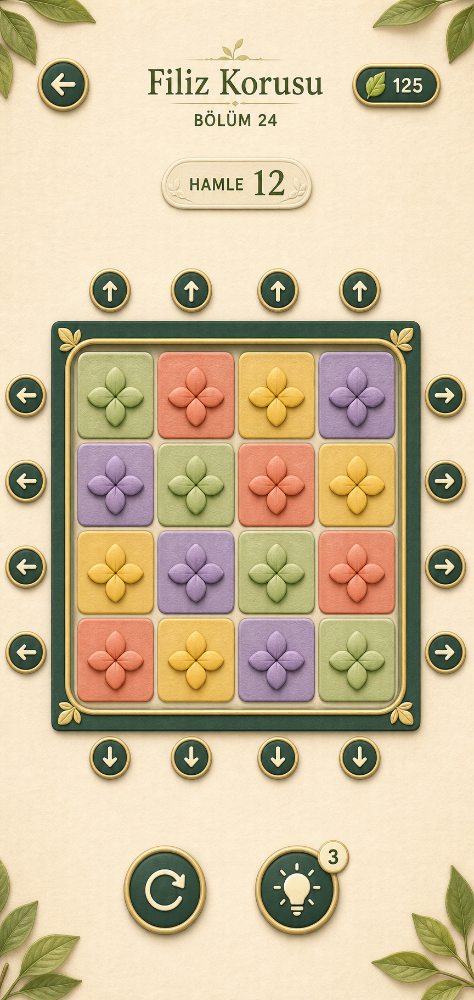
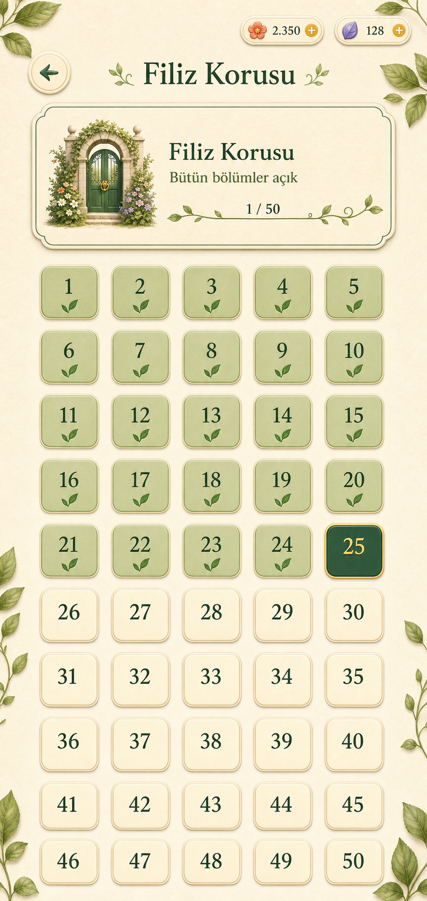
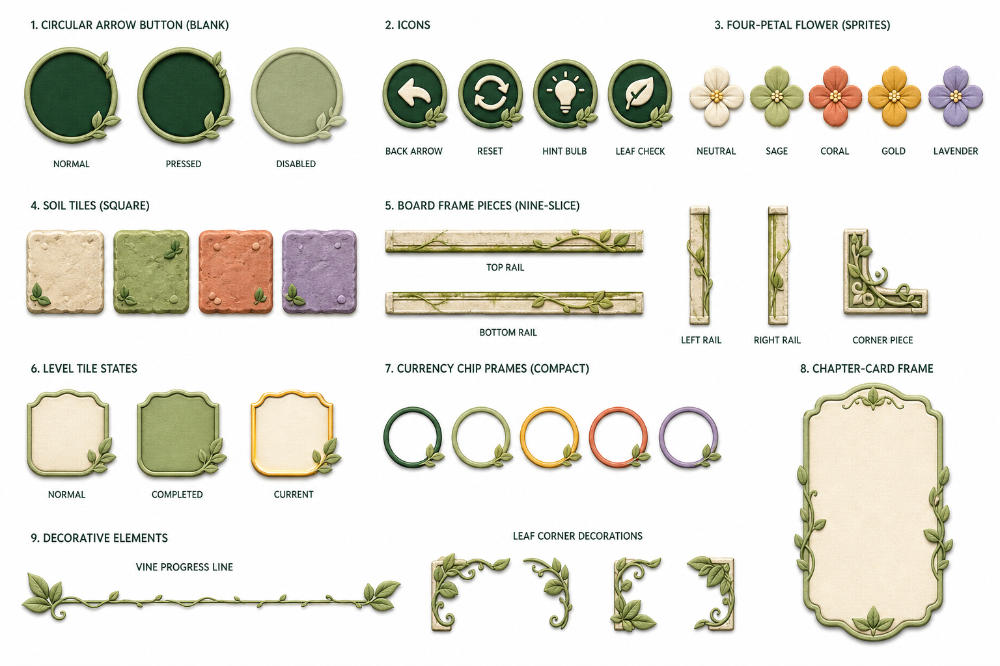

<p align="center">
  
</p>

<h1 align="center">Petal Shift: Bloom Puzzle</h1>

<p align="center">
  A tactile mobile puzzle game about shifting complete rows and columns to restore botanical patterns.
</p>

<p align="center">
  
  
  
  
</p>

## Overview

Petal Shift is a production mobile puzzle game built with Expo and React Native. Players drag an entire row or column; pieces wrap around the opposite edge and settle into place with responsive animation, sound and haptic feedback. The objective is to reproduce the target flower arrangement using as few moves as possible.

The project combines deterministic level generation with a handcrafted botanical visual system. Its difficulty expands from a compact 2×3 tutorial to 7×8 boards and gradually introduces additional colors without overwhelming the player.

<p align="center">
  
  
  
</p>

## Product highlights

- 738 deterministic puzzle levels across 12 garden layers and a three-level tutorial
- Row and column gestures with wrap-around movement and multi-cell dragging
- Progressive 2–5 color difficulty system and board sizes from 2×3 to 7×8
- One-to-three-star completion scoring and animated reward flow
- Context-aware hints derived from the generated solution path
- Turkish and English localization with first-launch language selection
- Persistent progression, settings, currencies and purchase restoration
- Adaptive phone and tablet layouts for iOS and Android
- Original botanical UI, sound effects, music, haptics and transitions
- AdMob interstitial/rewarded ads and StoreKit/Google Play in-app purchases

## Engineering highlights

- Seeded generation produces reproducible levels without storing hundreds of board files.
- Move normalization removes inverse and cyclic operations so hints do not waste player currency.
- Drag state is separated from committed board state to keep wrapped pieces stable during animation.
- Native-only services are guarded so unsupported runtimes degrade safely.
- Production identifiers are injected from ignored environment files; the repository defaults to Google's official test ad units.

## Tech stack

| Area | Technology |
| --- | --- |
| Application | React Native 0.81, React 19, TypeScript |
| Tooling | Expo SDK 54, EAS Build |
| Persistence | AsyncStorage |
| Audio and feedback | Expo Audio, Expo Haptics |
| Monetization | React Native Google Mobile Ads, React Native IAP |
| Store integration | Expo Store Review, iOS update lookup |

## Project structure

```text
.
├── App.tsx                 # Navigation, screens, interactions and service flows
├── src/
│   ├── game.ts             # Level generation, shifting and solution utilities
│   ├── storage.ts          # Versioned local player state
│   └── theme.ts            # Shared visual tokens
├── assets/                 # Runtime artwork, icons, music and sound effects
├── scripts/                # Store screenshot preparation tools
├── tools/                  # Asset generation helpers
├── app.config.js           # Environment-aware Expo configuration
├── app.json                # Public, safe application defaults
└── eas.json                # Development, preview and production profiles
```

## Run locally

Prerequisites: Node.js 20+, npm, Android Studio for Android, or a macOS/Xcode environment for local iOS builds.

```bash
npm install
cp .env.example .env
npx expo run:android
```

On Windows PowerShell, copy the environment template with:

```powershell
Copy-Item .env.example .env
```

The application uses native advertising and purchase modules, so Expo Go is not supported. Use a development build, then start Metro with:

```bash
npx expo start --dev-client
```

Without private production values, the project uses Google's official test advertising IDs. Never use test IDs in a store release.

## Environment configuration

Copy `.env.example` to `.env` and provide your own values. `.env` is intentionally excluded from Git.

| Variable | Purpose |
| --- | --- |
| `EXPO_OWNER` | Expo account or organization owner |
| `EAS_PROJECT_ID` | EAS project binding |
| `EXPO_PUBLIC_APP_STORE_ID` | Optional iOS version-check destination |
| `EXPO_PUBLIC_ADMOB_*_APP_ID` | Native AdMob application IDs |
| `EXPO_PUBLIC_ADMOB_*_INTERSTITIAL_ID` | Platform-specific interstitial units |
| `EXPO_PUBLIC_ADMOB_*_REWARDED_ID` | Platform-specific rewarded units |

For production EAS builds, configure the same values in the EAS environment instead of committing them.

## Verification

```bash
npx tsc --noEmit
npx expo config --type public
npx expo-doctor
```

## Availability

- [App Store](https://apps.apple.com/app/id6801522855)
- [Google Play](https://play.google.com/store/apps/details?id=com.gorsengames.ruzgarkorusu)

## Author

Designed and developed by **Görsen Games**. This repository is presented as a portfolio project demonstrating product design, mobile engineering, procedural puzzle generation and production store integration.

## License

Copyright © 2026 Görsen Games. All rights reserved. The source is available for portfolio review; copying, redistribution, resale and publishing derivative releases are not permitted without written authorization. See [LICENSE](LICENSE).
